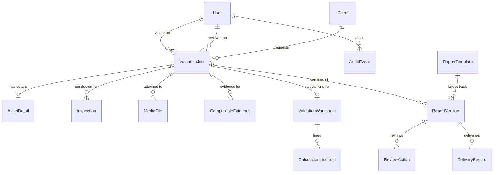

# Value Mark: System Architecture & Technical Decisions

This document records the architectural baseline and technical decisions for Value Mark's Valuation Management & Report Generation System.

---

## 1. Stack Overview

| Layer | Selection | Justification / Trade-offs |
|---|---|---|
| **Framework** | Next.js 15 (App Router, React 19, TypeScript strict) | Server components, Server Actions for mutations, unified deployment model. |
| **Styling & UI Primitives** | Tailwind CSS v4, Radix UI primitives, Lucide icons | Semantic markup, accessible keyboard navigation, high-density data tables. |
| **ORM & Migrations** | Prisma ORM | Strong type safety with PostgreSQL, robust migration tracking, schema clarity. |
| **Database** | PostgreSQL (Supabase / Self-hosted) | Standard relational engine with transactional integrity, JSONB support for category-specific attributes, and native decimal types (`Decimal(18, 2)` / `Decimal(15, 4)`). |
| **Authentication (Target: B2)** | Supabase Auth (or NextAuth / Auth.js v5) | Secure session cookies, password reset capabilities, native row security hooks if needed. |
| **Storage (Target: B4)** | Private Object Storage (Supabase Storage / S3-compatible) | Files and photos stored privately; served only via expiring signed URLs following permission validation. |
| **PDF Generation (Target: B6)** | Server-side Chromium (Playwright) / `@react-pdf/renderer` | Exact page breaks, headers/footers, tabular layout, and embedded photo grids. |
| **Validation** | Zod (shared schemas) | Client-side immediate feedback and strict server-side validation. |

---

## 2. Core Entities & Relationships

The database model follows the valuation assignment lifecycle:

---

## 3. Key Design Decisions & Constraints

### 3.1 Decimal Safety for Money
All currency and valuation amounts are typed as `Decimal` in Prisma and mapped to `DECIMAL(18, 2)` in PostgreSQL. Under no circumstance are JavaScript floating-point numbers used for monetary aggregation or final valuation determinations.

### 3.2 Immutability of Approved Reports
- `ReportVersion` records are locked once approved (`status = "APPROVED"`).
- Changes to an approved valuation job require generating a new `ReportVersion` incrementing the revision counter (`versionNumber`), preserving historical legal drafts and approval certificates.

### 3.3 Unique Reference Numbering
- Job references follow a configurable sequence rule (e.g. `VM-YYYY-XXXX`).
- Atomic reference generation is guaranteed via a dedicated sequence counter table with database-level transactions, avoiding collisions during concurrent job creation.

### 3.4 Private Media & File Separation
- Binary file assets are never saved directly in the database.
- The `MediaFile` table stores metadata, mime-type, magic-byte verification flags, and object storage storage keys.
- Client downloads require an authorized server request issuing a short-lived signed URL.

### 3.5 Append-Only Audit Logging
- `AuditEvent` records are append-only.
- All critical status transitions, worksheet updates, approvals, deliveries, and settings modifications record the actor ID, entity type, entity ID, action name, and a sanitized JSON diff.
